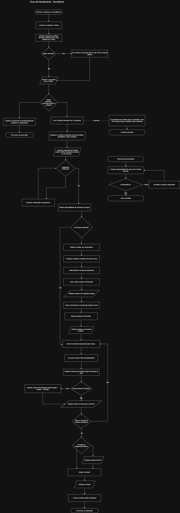

# 🏗️ Projeto Integrador — Modelagem de Dados
### Curso de Engenharia de Software — UNICID
**Professor:** Clovis Ferraro | **São Paulo — 2026**  
**Grupo 2** — Projeto ERP Space Metal (Serralheria — Empresa Real)

---

## 👥 Equipe

| Nome | RGM |
|---|---|
| Jonas Mateus de Sousa de Araújo | 47252766 |
| Marcos André Aragão da Cunha | 48229776 |
| Marlon Dias De Sousa | 47621915 |
| Murilo Souza dos Santos | 48108987 |
| Eduardo Chaves Santos | 48043087 |
| Guilherme Alves Raimundo | 48129861 |
| Paulo Peralta Soto | 49760432 |
| Daniel Santana Cavalcante | 47391812 |
| Kaike Domingos Silva | 47963352 |

---

## 📌 Contexto e Evolução da Modelagem

O projeto iniciou a modelagem conceitual com 9 entidades fundamentais (`CLIENTE`, `ORÇAMENTO`, `CONTRATO`, `SERVIÇO`, `PRODUTO`, `ESTOQUE`, `FORNECEDOR`, `PAGAMENTO` e `FUNCIONÁRIO`) e a regra pétrea de início dos trabalhos sob sinal mínimo de 30%. 

Após o aprofundamento do levantamento de processos e a devolutiva do professor Clovis Ferraro, o modelo foi **revisado, refinado e expandido** para integrar holisticamente as áreas comercial, suprimentos/compras, gestão de estoque por obra, produção e controle financeiro (contas a pagar, fluxo de caixa e conciliação bancária). 

A arquitetura atual conta com **16 entidades** e **6 entidades associativas** (que resolvem todas as relações N:N com atributos de negócio e rastreabilidade), além de triggers e constraints rigorosas no banco de dados relacional (MySQL).

---

## 🏢 1. Caracterização da Empresa (Etapa 1)

* **Nome Fantasia:** Space Metal
* **Segmento de Atuação:** Construção civil, com foco em estruturas metálicas e esquadrias de ferro/alumínio.
* **Portfólio de Produtos e Serviços:** Fabricação, instalação e manutenção de portões automáticos e manuais, grades, guarda-corpos, escadas retas e caracol, coberturas metálicas leves e estruturas personalizadas sob medida.
* **Principais Clientes:** Construtoras, empreiteiras de obras civis e clientes finais (residenciais e comerciais).
* **Setores de Atuação:** Construção civil e indústria.
* **Operação Atual:** O fluxo inicia com a solicitação do cliente e a visita técnica presencial para medição dos vãos. O orçamento é elaborado e, uma vez formalizado e aprovado com sinal pago, as peças são cortadas, soldadas e montadas na oficina, finalizando com transporte e instalação na obra. Atualmente, a gestão ainda depende de planilhas isoladas, anotações físicas e comunicação direta informal.
* **Informações Críticas para o Negócio:** Cadastro completo de clientes e contatos, medidas técnicas e especificações do projeto, orçamentos detalhados, prazos de entrega, cotações de matéria-prima, controle de estoque mínimo, custos reais de insumos consumidos por obra e controle de recebimentos e pagamentos.

---

## 📋 2. Justificativa da Escolha do Negócio (Etapa 2)

A escolha da **Space Metal** fundamenta-se na oportunidade real de modernização operacional através da tecnologia da informação em uma empresa do setor industrial/serralheria:

* **Processos Ricos para Análise:** A empresa possui uma cadeia de valor completa: captação, orçamento, contratação, cotação competitiva com fornecedores, compra, recebimento em estoque, manufatura/produção na oficina, instalação em campo e conciliação financeira. Esse encadeamento viabiliza uma modelagem de dados rica e fiel à realidade.
* **Gargalos na Centralização das Informações:** Há dispersão de dados entre os setores. A falta de comunicação entre equipe técnica e comercial gera compras emergenciais desnecessárias, desperdício de barras/chapas e falta de histórico de cotações passadas.
* **Necessidade Crítica de Integração:** É vital eliminar o ruído de comunicação entre o fechamento comercial (medidas, prazos e descontos) e o chão de fábrica (corte, solda e montagem), erradicando retrabalhos e atrasos de entrega.
* **Aderência à Solução ERP:** A automação e padronização dos orçamentos, contratos, compras baseadas em cotações, saldo mínimo de estoque e conciliação de caixa com extrato bancário resolvem diretamente as maiores dores de gestão da empresa.

---

## 🔄 3. Processos de Negócio Mapeados (Etapa 3)

| Processo | Participantes | Gatilho de Início | Atividades Realizadas | Resultado / Saída |
|---|---|---|---|---|
| **1. Orçamento** | CEO e Vendedora | Contato inicial do cliente solicitando cotação | Levantamento de medidas na obra, cálculo de materiais e margem, aplicação de desconto (autorizado pelo CEO), estipulação de validade (15 dias) | Orçamento emitido (`PENDENTE`), podendo evoluir para `APROVADO`, `RECUSADO` ou `EXPIRADO` |
| **2. Fechamento de Contrato e Pagamento** | CEO e Cliente | Aprovação formal de ambas as partes sobre o orçamento | Formalização contratual, estipulação de sinal mínimo (≥ 30%) e agendamento de parcelas (30 a 60 dias) | `CONTRATO` ativo gerado e títulos a receber registrados em `PAGAMENTO` |
| **3. Cotação de Matéria-Prima** | CEO e Fornecedores | Demanda de obra específica ou saldo de estoque atingindo quantidade mínima | Disparo de solicitação de preços a fornecedores parceiros, cadastro das propostas e comparação de prazos e valores unitários | Cotação vencedora marcada como `ACEITA` e demais como `RECUSADA`/`EXPIRADA` |
| **4. Pedido de Compra e Contas a Pagar** | CEO e Fornecedor | Cotação vencedora no status `ACEITA` | Emissão formal do pedido de compra amarrado à cotação, negociação de parcelas e recebimento dos materiais | `PEDIDO_COMPRA` emitido/recebido e geração das parcelas em `CONTA_PAGAR` |
| **5. Produção / Manufatura** | Equipe de Produção (Soldadores, Serralheiros) | Contrato ativo com sinal pago (≥ 30%) e insumos disponíveis | Corte, solda, montagem e acabamento das estruturas metálicas conforme as medidas acordadas | Serviço contratado produzido (`PENDENTE` → `EM_FABRICACAO` → `EM_INSTALACAO`) |
| **6. Entrega e Instalação** | Equipe de Montagem e Cliente | Peça pronta na oficina | Transporte da peça até o local da obra, fixação, regulagem e vistoria final com aceite do cliente | Serviço contratado finalizado (`CONCLUIDO`) |
| **7. Gestão Financeira e Conciliação** | CEO | Vencimento de parcelas a receber ou a pagar | Registro das baixas financeiras integrais ou parciais em `MOVIMENTAÇÃO_CAIXA` e cruzamento periódico com extrato bancário | Caixa conciliado (`CONCILIADO` ou `DIVERGENTE`) e pendências tratadas |
| **8. Controle de Estoque e Consumo** | CEO e Equipe de Produção | Recebimento de matéria-prima ou requisição de materiais para a obra | Registro de entradas (`ENTRADA` via pedido de compra) e saídas (`SAIDA` vinculada ao serviço contratado) | Saldo de `ESTOQUE` atualizado e apuração exata do custo de material por obra |
| **9. Encerramento do Contrato** | CEO e Cliente | Conclusão das instalações físicas | Verificação cumulativa de 100% dos serviços concluídos e 100% das parcelas quitadas | `CONTRATO` encerrado (`FINALIZADO`) |

---

## ⚠️ 4. Problemas e Necessidades Identificados (Etapa 4)

| Problema Identificado | Consequência no Negócio | Necessidade / Solução no Sistema |
|---|---|---|
| **Falta de gestão de compras** | Desperdício de material e sobras não reaproveitadas | Cadastro padronizado de produtos e requisições vinculadas |
| **Gestão manual de tempo** | Demora e descumprimento de prazos de entrega acordados | Acompanhamento por status de execução (`EM_FABRICACAO`, `EM_INSTALACAO`, `CONCLUIDO`) |
| **Desorganização no relacionamento com o cliente** | Ruídos de comunicação e perda de histórico de negociação | Centralização do histórico de orçamentos, alterações e contratos do cliente |
| **Falta de planejamento técnico** | Retrabalhos em campo durante a montagem das peças | Especificação rígida de medidas e serviços contratados por contrato |
| **Cotações informais e não comparáveis** | Impossibilidade de auditar se a compra foi no melhor preço | Entidades `COTACAO` e `ITEM_COTACAO` comparando propostas de fornecedores |
| **Compras emergenciais às pressas** | Atraso nas obras e pagamento de sobrepreço aos fornecedores | Monitoramento de `quantidade_minima` no estoque com disparo preventivo de cotação |
| **Ausência de contas a pagar e fluxo de caixa** | Risco de descompasso de caixa (pagar fornecedores antes de receber sinal) | Entidades `CONTA_PAGAR` e `MOVIMENTACAO_CAIXA` com suporte a pagamentos parciais |
| **Saída de estoque sem rastreabilidade da obra** | Desconhecimento do custo real e da lucratividade de cada contrato | `MOVIMENTACAO_ESTOQUE` com vínculo obrigatório a `SERVICO_CONTRATADO` (na saída) |
| **Mistura de serviços de catálogo com a execução na obra** | Perda das dimensões reais dos vãos e de valores negociados | Separação explícita entre `SERVICO` (catálogo base) e `SERVICO_CONTRATADO` (execução real) |
| **Ausência de conciliação bancária** | Extravio de lançamentos, fraudes ou inconsistências contábeis | Entidades `LANCAMENTO_EXTRATO` e `CONCILIACAO` auditando cada movimentação de caixa |

---

## 🎯 5. Requisitos Funcionais (Etapa 5)

| Código | Requisito Funcional | Situação no Levantamento |
|---|---|---|
| **RF01** | O sistema deverá realizar o controle de estoque de matéria-prima e insumos. | Confirmado |
| **RF02** | O sistema deverá registrar e controlar a jornada de trabalho dos funcionários. | Fora de Escopo *(não prioritário)* |
| **RF03** | O sistema deverá servir como intermédio e histórico de contato entre a empresa e o cliente. | Confirmado |
| **RF04** | O sistema deverá permitir a personalização das dimensões e características dos serviços. | Confirmado |
| **RF05** | O sistema deverá consolidar as informações necessárias para a geração automática do contrato. | Confirmado |
| **RF06** | O sistema deverá calcular e apresentar o preço base e custos dos serviços/produtos. | Confirmado |
| **RF07** | O sistema deverá estimar o tempo e prazo previsto de execução de cada serviço. | Confirmado |
| **RF08** | O sistema deverá cadastrar clientes (pessoas físicas com CPF e pessoas jurídicas com CNPJ). | Confirmado |
| **RF09** | O sistema deverá registrar orçamentos vinculados a um cliente específico. | Confirmado |
| **RF10** | O sistema deverá permitir a aprovação ou recusa do orçamento, registrando o histórico de interações. | Confirmado |
| **RF11** | O sistema deverá converter automaticamente um orçamento aprovado em contrato formal. | Confirmado |
| **RF12** | O sistema deverá registrar os pagamentos vinculados ao contrato, permitindo parcelamentos em 30 a 60 dias. | Confirmado |
| **RF13** | O sistema deverá impedir o início da produção/fabricação sem a confirmação do pagamento do sinal (≥ 30%). | Confirmado |
| **RF14** | O sistema deverá cadastrar colaboradores e alocá-los aos serviços que executam. | Confirmado |
| **RF15** | O sistema deverá cadastrar fornecedores e registrar propostas de cotação com itens, preços e prazos. | Confirmado |
| **RF16** | O sistema deverá permitir a consulta do histórico consolidado de orçamentos, contratos e pagamentos por cliente. | Confirmado |
| **RF17** | O sistema deverá registrar descontos aplicados (até 3% padrão, ou até 10% em serviços rápidos autorizado pelo CEO). | Confirmado |
| **RF18** | O sistema deverá registrar cancelamentos de contrato calculando a retenção contratual de 5% dos valores pagos. | Confirmado |
| **RF19** | O sistema deverá comparar cotações de fornecedores, marcando a vencedora (`ACEITA`) e as demais (`RECUSADA`/`EXPIRADA`). | Confirmado *(Refinamento)* |
| **RF20** | O sistema deverá emitir pedido de compra exclusivamente a partir de uma cotação aceita e registrar o recebimento. | Confirmado *(Refinamento)* |
| **RF21** | O sistema deverá gerar as parcelas de contas a pagar a partir do pedido de compra formalizado. | Confirmado *(Refinamento)* |
| **RF22** | O sistema deverá registrar os serviços contratados (medidas, quantidade, valor acordado e status) e alocar os funcionários responsáveis. | Confirmado *(Refinamento)* |
| **RF23** | O sistema deverá registrar entradas de estoque (por pedido de compra) e saídas (por serviço contratado). | Confirmado *(Refinamento)* |
| **RF24** | O sistema deverá emitir alertas para produtos cuja quantidade atual atinja ou fique abaixo da quantidade mínima. | Confirmado *(Refinamento)* |
| **RF25** | O sistema deverá registrar movimentações de caixa de entrada (recebimentos) e saída (pagamentos), suportando amortizações parciais. | Confirmado *(Refinamento)* |
| **RF26** | O sistema deverá importar os lançamentos do extrato bancário e conciliá-los com as movimentações de caixa. | Confirmado *(Refinamento)* |
| **RF27** | O sistema deverá finalizar o contrato somente sob a condição cumulativa de 100% dos serviços concluídos e 100% das parcelas quitadas. | Confirmado *(Refinamento)* |
| **RF28** | O sistema deverá apurar e informar o custo real consolidado de matéria-prima consumida por obra/contrato. | Confirmado *(Refinamento)* |

---

## ⚙️ 6. Requisitos Não Funcionais (Etapa 6)

| Código | Requisito Não Funcional | Categoria |
|---|---|---|
| **RNF01** | O sistema deverá possuir interface responsiva para operação em computadores da oficina, tablets e smartphones. | Usabilidade |
| **RNF02** | O sistema deverá ter interface amigável e simplificada, adequada a operadores sem conhecimento técnico avançado de TI. | Usabilidade |
| **RNF03** | O sistema deverá implementar controle de acesso baseado em papéis (CEO, Vendedora e Produção), com privilégios irrestritos restritos ao CEO e Vendedora. | Segurança |
| **RNF04** | O sistema deverá registrar logs de auditoria contendo data, hora, autor e operação realizada em registros críticos. | Confiabilidade / Auditoria |
| **RNF05** | O sistema deverá responder a consultas operacionais e cadastros com tempo de resposta inferior a 2 segundos. | Desempenho |
| **RNF06** | O sistema deverá garantir alta disponibilidade durante o horário comercial e o turno operacional da serralheria. | Disponibilidade |
| **RNF07** | O sistema deverá garantir a privacidade e segurança dos dados cadastrais (LGPD), expondo apenas dados pertinentes nos contratos. | Segurança / Privacidade |
| **RNF08** | O banco de dados deverá garantir integridade referencial e regras de domínio no nível de SGBD através de constraints (`PK`, `FK`, `UNIQUE`, `NOT NULL`, `CHECK`). | Integridade |
| **RNF09** | Toda movimentação de materiais e de recursos financeiros deverá manter rastreabilidade obrigatória de sua origem documental. | Rastreabilidade |

---

## 📏 7. Regras de Negócio (Etapa 7)

| Código | Descrição da Regra de Negócio | Entidades Envolvidas |
|---|---|---|
| **RN01** | Todo contrato exige o recebimento confirmado de pelo menos 30% do valor total a título de sinal antes de iniciar qualquer trabalho de produção ou instalação. | `CONTRATO`, `PAGAMENTO`, `SERVIÇO_CONTRATADO` |
| **RN02** | Um cliente pode manter múltiplos orçamentos e contratos abertos simultaneamente no sistema. | `CLIENTE`, `ORÇAMENTO`, `CONTRATO` |
| **RN03** | Orçamentos recusados pelo cliente não são excluídos; permanecem registrados no banco com o histórico da interação para fins estatísticos e comerciais. | `ORÇAMENTO`, `CLIENTE` |
| **RN04** | Um orçamento só é convertido em contrato mediante aprovação mútua formal entre a Space Metal e o cliente. | `ORÇAMENTO`, `CONTRATO` |
| **RN05** | O saldo do contrato pode ser parcelado em prazos entre 30 e 60 dias conforme estipulado na negociação. | `CONTRATO`, `PAGAMENTO` |
| **RN06** | Um funcionário pode estar alocado simultaneamente na execução de múltiplos serviços contratados. | `FUNCIONÁRIO`, `SERVIÇO_CONTRATADO` |
| **RN07** | Toda aquisição de matéria-prima deve passar por cotação comparativa de preços entre fornecedores; cada pedido deriva de uma cotação formalmente aceita. | `FORNECEDOR`, `COTAÇÃO`, `ITEM_COTAÇÃO`, `PEDIDO_COMPRA`, `PRODUTO` |
| **RN08** | Um fornecedor pode cotar e fornecer múltiplos materiais; a amarração entre fornecedor e produto se estabelece nas cotações. | `FORNECEDOR`, `COTAÇÃO`, `ITEM_COTAÇÃO`, `PRODUTO` |
| **RN09** | Os orçamentos emitidos possuem prazo de validade determinado (padrão de 15 dias). | `ORÇAMENTO` |
| **RN10** | Concessões de desconto são limitadas a até 3% para condições normais e devem ser obrigatoriamente aprovadas pelo CEO. | `ORÇAMENTO`, `CONTRATO` |
| **RN11** | Em caso de cancelamento do contrato após assinatura formal, a empresa retém 5% do valor total já desembolsado pelo cliente a título de custos administrativos. | `CONTRATO`, `PAGAMENTO` |
| **RN12** | Todo serviço executado consome matéria-prima do estoque, cuja baixa (`SAIDA`) deve estar vinculada à obra. | `SERVIÇO_CONTRATADO`, `ESTOQUE`, `MOVIMENTAÇÃO_ESTOQUE` |
| **RN13** | Em casos específicos (como serviços rápidos de pronta execução), o desconto comercial pode atingir até 10%, sob anuência do CEO. | `ORÇAMENTO`, `CONTRATO` |
| **RN14** | Diferenciação estrita de escopo: `SERVIÇO` representa o catálogo base da empresa; `SERVIÇO_CONTRATADO` representa a execução real na obra com dimensões do vão, valor e status. | `SERVIÇO`, `SERVIÇO_CONTRATADO` |
| **RN15** | Todo serviço contratado em execução deve possuir pelo menos um colaborador técnico responsável associado. | `SERVIÇO_CONTRATADO`, `FUNCIONÁRIO` |
| **RN16** | A escala dos colaboradores é organizada por Ordem de Serviço na tabela associativa `executa`. | `FUNCIONÁRIO`, `SERVIÇO_CONTRATADO`, `executa` |
| **RN17** | Um pedido de compra só pode ser emitido com base em uma cotação com status `ACEITA`, gerando no máximo um pedido por cotação. | `COTAÇÃO`, `PEDIDO_COMPRA` |
| **RN18** | Todo pedido de compra gera uma ou mais parcelas a pagar; a numeração da parcela é sequencial e única dentro do mesmo pedido. | `PEDIDO_COMPRA`, `CONTA_PAGAR` |
| **RN19** | A confirmação do recebimento físico do pedido de compra gera automaticamente movimentações de `ENTRADA` no estoque vinculadas ao pedido. | `PEDIDO_COMPRA`, `MOVIMENTAÇÃO_ESTOQUE`, `ESTOQUE` |
| **RN20** | Toda movimentação de `SAIDA` de estoque deve referenciar o `SERVICO_CONTRATADO` solicitante, e o saldo físico em estoque não pode ser negativo. | `MOVIMENTAÇÃO_ESTOQUE`, `SERVIÇO_CONTRATADO`, `ESTOQUE` |
| **RN21** | Quando o saldo físico de um produto atingir patamar igual ou inferior à `quantidade_minima`, o sistema alerta a necessidade de nova cotação de reposição. | `ESTOQUE`, `PRODUTO`, `COTAÇÃO` |
| **RN22** | Cada produto cadastrado no catálogo possui exatamente um registro de estoque correspondente (relação 1:1 onde PK é FK). | `PRODUTO`, `ESTOQUE` |
| **RN23** | Pagamentos a receber e contas a pagar podem ser amortizados em parcelas parciais; cada quitação gera um registro em `MOVIMENTAÇÃO_CAIXA`. Um título só fica `PAGO` se tiver data de quitação. | `PAGAMENTO`, `CONTA_PAGAR`, `MOVIMENTAÇÃO_CAIXA` |
| **RN24** | As movimentações de caixa são auditadas contra os lançamentos do extrato bancário; cada conciliação é marcada como `CONCILIADO` ou `DIVERGENTE`. | `MOVIMENTAÇÃO_CAIXA`, `LANÇAMENTO_EXTRATO`, `CONCILIAÇÃO` |
| **RN25** | Um contrato só pode ter seu status alterado para `FINALIZADO` mediante o cumprimento cumulativo de duas condições: 100% dos serviços concluídos e 100% das parcelas pagas. | `CONTRATO`, `SERVIÇO_CONTRATADO`, `PAGAMENTO` |
| **RN26** | O percentual de sinal pactuado no contrato deve situar-se obrigatoriamente entre 30% e 100%. | `CONTRATO` |

---

## 🏛️ 8. Restrições e Políticas Organizacionais (Etapa 8)

* **Privacidade de Dados:** O sistema armazena informações completas de contato e endereço de clientes e fornecedores, mas expõe no instrumento contratual impresso apenas as informações legais estritamente necessárias.
* **Controle de Acesso por Perfil:** Apenas o CEO e a Vendedora possuem autorização para visualização irrestrita de valores, relatórios de lucratividade e fluxo de caixa. A equipe operacional da oficina acessa unicamente especificações técnicas de produção.
* **Aprovação Centralizada de Operações:** Modificações contratuais, estornos, cadastro de novos fornecedores e alteração de parâmetros mestres exigem aprovação direta do CEO.
* **Política de Descontos:** O teto de desconto é rigorosamente controlado pelo SGBD via constraint `CHECK` (entre 0% e 10%), requerendo validação do CEO.
* **Condições de Liquidação Financeira:** As transações são realizadas prioritariamente via Pix e TED, com registro discriminado do método em cada movimentação de caixa.
* **Política de Cancelamento:** Contratos cancelados após o início da vigência ensejam a retenção administrativa de 5% sobre os montantes pagos, com liberação de saldo remanescente via tesouraria.
* **Política de Estoque ("Não Deixar Zerar"):** Política preventiva de estoque mínimo para evitar a paralisação do maquinário de corte e solda.
* **Política de Compras:** Nenhuma ordem de compra de suprimentos pode ser efetuada sem antes registrar e comparar no mínimo propostas cotadas.
* **Política de Caixa e Tesouraria:** Auditoria regular através da conferência cruzada obrigatória entre movimentações registradas internamente e o extrato bancário oficial.

---

## 🗺️ 9. Fluxograma dos Processos (Etapa 9)

O fluxograma abaixo detalha o ciclo operacional completo da Space Metal — desde o atendimento ao cliente, visitas técnicas, emissão de orçamentos, cotações com fornecedores, produção na oficina até a instalação final e conciliação financeira:



---

## 🧩 10. Entidades do Modelo (Etapa 10)

O modelo relacional é composto por **16 entidades**:

| Entidade | Tipo | Justificativa no Domínio do Negócio |
|---|---|---|
| **`CLIENTE`** | Forte | Representa as construtoras, empreiteiras e clientes finais que contratam os serviços. Identificado naturalmente por CPF/CNPJ. |
| **`ORÇAMENTO`** | Dependente (FK `cpf_cnpj`) | Armazena as propostas orçamentárias emitidas, mantendo histórico de orçamentos pendentes, aprovados e recusados (RN03). |
| **`CONTRATO`** | Dependente (FK `codigo_orcamento`, UQ) | Formaliza juridicamente o orçamento aprovado por ambas as partes (RN04), estipulando sinal (RN01) e vigência. |
| **`SERVIÇO`** | Forte | Catálogo base de serviços oferecidos pela serralheria (ex.: Portão Basculante, Escada Metálica, Grade de Proteção) com valores e prazos médios de referência. |
| **`SERVIÇO_CONTRATADO`** | Dependente (FKs `codigo_contrato`, `id_servico`) | Instância de execução real na obra, contendo as medidas específicas do vão, quantidade, valor fechado e status produtivo. |
| **`PRODUTO`** | Forte | Catálogo de matérias-primas e insumos (tubos de aço, chapas xadrez, perfis, abrasivos, tintas). |
| **`ESTOQUE`** | Dependente (PK = FK `codigo_produto`, 1:1) | Armazena a posição física de saldo atual e nível mínimo de cada produto no almoxarifado central. |
| **`MOVIMENTAÇÃO_ESTOQUE`** | Dependente (FK `codigo_produto`) | Registra todo fluxo físico (entradas via pedidos de compra e saídas alocadas diretamente às obras). |
| **`FORNECEDOR`** | Forte | Empresas parceiras que fornecem aço, perfis, ferragens e insumos industriais. Identificado por CNPJ. |
| **`COTAÇÃO`** | Dependente (FK `id_fornecedor`) | Registra as propostas comerciais de preços e prazos enviadas pelos fornecedores participantes da concorrência (RN07). |
| **`PEDIDO_COMPRA`** | Dependente (FK `id_cotacao`, UQ) | Formalização de compra gerada estritamente sobre a cotação declarada vencedora (`ACEITA`). |
| **`CONTA_PAGAR`** | Dependente (FK `id_pedido_compra`) | Obrigações financeiras assumidas pela empresa, desmembradas em parcelas com vencimento e valor. |
| **`PAGAMENTO`** | Dependente (FK `codigo_contrato`) | Direitos creditórios e títulos a receber gerados a partir do contrato (sinal inicial e parcelas). |
| **`MOVIMENTAÇÃO_CAIXA`** | Dependente (FKs opcionais `id_pagamento`, `id_conta_pagar`) | Registra o fluxo de caixa real (entradas de clientes e saídas para fornecedores), suportando quitações parciais. |
| **`LANÇAMENTO_EXTRATO`** | Forte | Representa as transações financeiras consolidadas na conta bancária oficial da empresa. |
| **`FUNCIONÁRIO`** | Forte | Cadastro dos colaboradores (soldadores, montadores, operadores de corte, projetistas) alocados na fabricação. |

---

## 🗄️ 11. Diagrama Entidade-Relacionamento (DER) (Etapa 16)

O diagrama conceitual/lógico abaixo reflete o modelo validado, demonstrando a resolução das relações N:N através de entidades associativas e a integração de todos os submódulos da serralheria:

.png>)

---

## 🔗 12. Relacionamentos e Cardinalidades (Etapas 12 e 13)

| Relacionamento | Lado A | Lado B | Cardinalidade | Justificativa de Negócio |
|---|---|---|:---:|---|
| **CLIENTE solicita ORÇAMENTO** | CLIENTE | ORÇAMENTO | **(0,N) : (1,1)** | Um cliente pode solicitar múltiplos orçamentos ao longo do tempo ou nenhum. Cada orçamento pertence obrigatoriamente a um único cliente cadastrado. |
| **ORÇAMENTO possui CONTRATO** | ORÇAMENTO | CONTRATO | **(0,1) : (1,1)** | Orçamentos pendentes, recusados ou expirados não possuem contrato; se aprovado, gera no máximo um contrato. Todo contrato deriva de um orçamento aprovado único. |
| **ORÇAMENTO contém SERVIÇO** | ORÇAMENTO | SERVIÇO | **(1,N) : (0,N)** | N:N resolvido pela associativa `contem`. Um orçamento contém um ou mais serviços; um tipo de serviço do catálogo pode figurar em vários orçamentos. |
| **CONTRATO exige PAGAMENTO** | CONTRATO | PAGAMENTO | **(1,N) : (1,1)** | Todo contrato formalizado gera ao menos um pagamento (o sinal obrigatório de 30%) e eventuais parcelas. Cada título a receber é de um único contrato. |
| **CONTRATO contrata SERVIÇO_CONTRATADO** | CONTRATO | SERVIÇO_CONTRATADO | **(1,N) : (1,1)** | Um contrato engloba um ou mais serviços a serem executados na obra. Cada serviço contratado pertence exclusivamente a um contrato. |
| **SERVIÇO especifica SERVIÇO_CONTRATADO** | SERVIÇO | SERVIÇO_CONTRATADO | **(0,N) : (1,1)** | Um serviço de catálogo pode ser referenciado em inúmeras obras ou em nenhuma. Cada serviço contratado especifica um tipo de serviço do catálogo. |
| **SERVIÇO precisa PRODUTO** | SERVIÇO | PRODUTO | **(0,N) : (0,N)** | N:N resolvido pela associativa `precisa`. Um serviço padrão consome múltiplos insumos, e um produto atende a diversos tipos de serviço. |
| **FUNCIONÁRIO executa SERVIÇO_CONTRATADO** | FUNCIONÁRIO | SERVIÇO_CONTRATADO | **(0,N) : (1,N)** | N:N resolvido pela associativa `executa`. Um colaborador pode atuar em várias obras simultâneas; todo serviço contratado deve ter ao menos um responsável. |
| **PRODUTO tem ESTOQUE** | PRODUTO | ESTOQUE | **(1,1) : (1,1)** | Cada produto do catálogo possui exatamente uma linha de saldo físico no estoque (PK = FK), garantindo unicidade de almoxarifado. |
| **PRODUTO sofre MOVIMENTAÇÃO_ESTOQUE** | PRODUTO | MOVIMENTAÇÃO_ESTOQUE | **(0,N) : (1,1)** | Um produto pode registrar histórico de inúmeras movimentações. Toda movimentação de estoque movimenta exatamente um produto. |
| **SERVIÇO_CONTRATADO consome MOVIMENTAÇÃO_ESTOQUE** | SERVIÇO_CONTRATADO | MOVIMENTAÇÃO_ESTOQUE | **(0,N) : (0,1)** | Uma obra consome materiais ao longo do tempo (várias saídas). Uma movimentação de saída aponta a obra atendida; uma movimentação de entrada não possui obra vinculada. |
| **PEDIDO_COMPRA abastece MOVIMENTAÇÃO_ESTOQUE** | PEDIDO_COMPRA | MOVIMENTAÇÃO_ESTOQUE | **(0,N) : (0,1)** | A entrega de um pedido gera movimentações de entrada para seus itens. Movimentações de saída não se vinculam a pedidos de compra. |
| **FORNECEDOR envia COTAÇÃO** | FORNECEDOR | COTAÇÃO | **(0,N) : (1,1)** | Um fornecedor cadastrado pode enviar diversas propostas de preços ao longo do tempo. Cada cotação é de autoria de um único fornecedor. |
| **COTAÇÃO origina PEDIDO_COMPRA** | COTAÇÃO | PEDIDO_COMPRA | **(0,1) : (1,1)** | Cotações derrotadas ou expiradas não geram compras; a cotação aceita gera no máximo um pedido formal de fornecimento. |
| **COTAÇÃO cota PRODUTO** | COTAÇÃO | PRODUTO | **(1,N) : (0,N)** | N:N resolvido por `item_cotacao`. Uma proposta de cotação discrimina quantidades e preços unitários ofertados para um ou mais produtos. |
| **PEDIDO_COMPRA compra PRODUTO** | PEDIDO_COMPRA | PRODUTO | **(1,N) : (0,N)** | N:N resolvido por `item_pedido_compra`. O pedido de compra consolida os itens, quantidades e preços unitários acordados no fechamento. |
| **PEDIDO_COMPRA gera CONTA_PAGAR** | PEDIDO_COMPRA | CONTA_PAGAR | **(1,N) : (1,1)** | Todo pedido de compra gera uma ou mais parcelas a serem quitadas para o fornecedor. Cada parcela a pagar decorre de um pedido específico. |
| **PAGAMENTO quitado por MOVIMENTAÇÃO_CAIXA** | PAGAMENTO | MOVIMENTAÇÃO_CAIXA | **(0,N) : (0,1)** | Um título a receber do cliente pode ser pago integralmente ou amortizado em parcelas parciais. A movimentação de entrada de caixa liquida o título. |
| **CONTA_PAGAR quitada por MOVIMENTAÇÃO_CAIXA** | CONTA_PAGAR | MOVIMENTAÇÃO_CAIXA | **(0,N) : (0,1)** | Uma duplicata de fornecedor pode ser quitada em parcelas parciais. Cada saída financeira do caixa registra a baixa do documento. |
| **MOVIMENTAÇÃO_CAIXA conciliada com LANÇAMENTO_EXTRATO** | MOVIMENTAÇÃO_CAIXA | LANÇAMENTO_EXTRATO | **(0,N) : (0,N)** | N:N resolvido pela associativa `conciliacao`. Um lançamento bancário pode consolidar várias baixas internas (ou vice-versa), registrando status de auditoria. |

---

## 🔀 13. Verificação e Resolução dos Relacionamentos N:N (Etapas 14 e 15)

O modelo relacional identifica e decompõe **6 relacionamentos N:N** através de entidades associativas especializadas, dotadas de chaves primárias e atributos próprios de negócio:

| Tabela Associativa | Relação N:N Decomposta | Estrutura de Chaves | Atributos Próprios | Papel de Negócio no ERP |
|---|---|---|---|---|
| **`contem`** | `ORÇAMENTO` ↔ `SERVIÇO` | **PK Composta:** (`codigo_orcamento`, `id_servico`) | `medidas`, `sub_total`, `quantidade` | Discrimina a composição de serviços e seus valores parciais orçados para o cliente. |
| **`precisa`** | `SERVIÇO` ↔ `PRODUTO` | **PK Composta:** (`id_servico`, `codigo_produto`) | `quantidade_necessaria` | Define a lista padrão de materiais (BOM - *Bill of Materials*) necessária para fabricar cada serviço. |
| **`executa`** | `FUNCIONÁRIO` ↔ `SERVIÇO_CONTRATADO` | **PK Composta:** (`id_funcionario`, `id_servico_contratado`) | *(Relacionamento Puro)* | Registra a escala da equipe técnica (serralheiros, soldadores, instaladores) alocada na ordem de serviço da obra. |
| **`item_cotacao`** | `COTAÇÃO` ↔ `PRODUTO` | **PK Composta:** (`id_cotacao`, `codigo_produto`) | `quantidade`, `preco_unitario` | Registra os preços unitários e volumes propostos por cada fornecedor para efeito de comparação competitiva. |
| **`item_pedido_compra`** | `PEDIDO_COMPRA` ↔ `PRODUTO` | **PK Artificial:** `id_item_pedido` (AI)<br>**UQ Composta:** (`id_pedido_compra`, `codigo_produto`) | `quantidade`, `preco_unitario` | Congela os preços unitários e quantidades finais acordadas na compra formal de reposição. |
| **`conciliacao`** | `MOVIMENTAÇÃO_CAIXA` ↔ `LANÇAMENTO_EXTRATO` | **PK Composta:** (`id_lancamento`, `id_mov_caixa`) | `data_conciliacao`, `status`, `observacao` | Cruza as operações de caixa interno com o extrato bancário oficial, auditando divergências (`CONCILIADO` ou `DIVERGENTE`). |

---

## 📖 14. Dicionário de Dados Conceitual e Físico (Etapa 17)

Abaixo está o detalhamento estrutural de todas as **16 tabelas de entidade** e **6 tabelas associativas**, implementadas rigorosamente no script [`SQL/Banco de dados.sql`](SQL/Banco%20de%20dados.sql).

### Convenções de Restrições
* **PK:** Chave Primária | **FK:** Chave Estrangeira | **AI:** Auto Incremento
* **NN:** Not Null (Preenchimento Obrigatório) | **UQ:** Unique (Valor Único) | **CHECK:** Restrição de Domínio / Validação

---

### Entidades Independentes

#### 1. Tabela `cliente`
| Atributo | Tipo SQL | Chave | Restrições / Regras | Descrição do Domínio |
|---|---|:---:|---|---|
| `cpf_cnpj` | `VARCHAR(14)` | **PK** | NN, CHECK (11 ou 14 dígitos) | Chave natural única do cliente (CPF para pessoa física, CNPJ para jurídica). |
| `nome` | `VARCHAR(30)` | | NN | Primeiro nome do cliente ou razão social simplificada. |
| `sobrenome` | `VARCHAR(50)` | | NN | Sobrenome do cliente ou complemento empresarial. |
| `email` | `VARCHAR(60)` | | NN | E-mail de contato principal para envio de orçamentos e notas. |
| `cep` | `VARCHAR(9)` | | Formato '00000-000' | CEP do endereço de faturamento/contato. |
| `rua` | `VARCHAR(60)` | | | Logradouro do endereço. |
| `numero` | `VARCHAR(10)` | | | Número do imóvel. |
| `complemento`| `VARCHAR(30)` | | | Complemento (bloco, sala, andar). |
| `bairro` | `VARCHAR(40)` | | | Bairro do endereço. |
| `cidade` | `VARCHAR(40)` | | | Município de localização. |
| `uf` | `CHAR(2)` | | Sigla estadual | Unidade Federativa. |
| `ddd` | `VARCHAR(2)` | | NN | Código de Discagem Direta a Distância. |
| `telefone` | `VARCHAR(9)` | | | Número do telefone ou celular. |

#### 2. Tabela `fornecedor`
| Atributo | Tipo SQL | Chave | Restrições / Regras | Descrição do Domínio |
|---|---|:---:|---|---|
| `id_fornecedor` | `INT` | **PK** | AI | Identificador sequencial do fornecedor parceiro. |
| `nome` | `VARCHAR(50)` | | NN | Razão social ou nome fantasia do fornecedor. |
| `cnpj` | `CHAR(14)` | | NN, UQ | CNPJ único do fornecedor (14 dígitos). |
| `ddd` | `VARCHAR(2)` | | NN | Código DDD telefônico. |
| `telefone` | `VARCHAR(9)` | | | Telefone de contato comercial. |
| `email` | `VARCHAR(60)` | | NN | E-mail comercial para disparo de solicitações de cotação. |
| `cep` | `VARCHAR(9)` | | | Código Postal do endereço do fornecedor. |
| `rua` | `VARCHAR(60)` | | | Logradouro da sede ou depósito do fornecedor. |
| `numero` | `VARCHAR(10)` | | | Número predial. |
| `complemento`| `VARCHAR(30)` | | | Complemento do endereço. |
| `bairro` | `VARCHAR(40)` | | | Bairro da sede. |
| `cidade` | `VARCHAR(40)` | | | Cidade sede. |
| `uf` | `CHAR(2)` | | | Estado sede. |
| `tipo_material`| `VARCHAR(30)` | | | Especialidade principal (Tubos de Aço, Chapas, Ferragens, Insumos). |

#### 3. Tabela `produto`
| Atributo | Tipo SQL | Chave | Restrições / Regras | Descrição do Domínio |
|---|---|:---:|---|---|
| `codigo_produto`| `INT` | **PK** | AI | Identificador numérico único do produto. |
| `nome` | `VARCHAR(50)` | | NN | Descrição comercial do material (ex: Tubo Industrial 50x50). |
| `tipo` | `VARCHAR(20)` | | | Classificação interna (Matéria-Prima, Insumo, Acabamento). |
| `material` | `VARCHAR(20)` | | | Composição básica (Aço Carbono, Galvanizado, Alumínio, Ferro Fundido). |
| `descricao` | `VARCHAR(100)` | | | Detalhamento técnico dimensional e normas aplicáveis. |
| `unidade_medida`| `VARCHAR(10)` | | NN | Unidade comercial padrão (UN, Barra, Metro, Kg, Caixa). |
| `preco` | `DECIMAL(10,2)` | | NN, CHECK (`preco > 0`) | Preço de custo base para balizamento de orçamentos. |

#### 4. Tabela `servico`
| Atributo | Tipo SQL | Chave | Restrições / Regras | Descrição do Domínio |
|---|---|:---:|---|---|
| `id_servico` | `INT` | **PK** | AI | Código identificador do tipo de serviço do catálogo. |
| `tipo_servico` | `VARCHAR(40)` | | NN | Denominação da categoria (Portão Basculante, Escada Helicoidal, Guarda-Corpo). |
| `valor` | `DECIMAL(10,2)` | | NN, CHECK (`valor > 0`) | Preço base de referência tabelado da execução. |
| `prazo_entrega`| `INT` | | NN, CHECK (`prazo_entrega > 0`)| Estimativa média padrão de dias úteis para execução. |
| `descricao` | `VARCHAR(100)` | | | Especificações padrão do serviço e método construtivo. |
| `status` | `VARCHAR(15)` | | NN, DEFAULT 'ATIVO', CHECK in ('ATIVO','INATIVO') | Disponibilidade comercial do serviço no catálogo. |

#### 5. Tabela `funcionario`
| Atributo | Tipo SQL | Chave | Restrições / Regras | Descrição do Domínio |
|---|---|:---:|---|---|
| `id_funcionario`| `INT` | **PK** | AI | Código funcional do colaborador da Space Metal. |
| `nome` | `VARCHAR(20)` | | NN | Primeiro nome do colaborador. |
| `sobrenome` | `VARCHAR(40)` | | | Sobrenome do colaborador. |
| `cpf` | `CHAR(11)` | | NN, UQ | Cadastro de Pessoa Física do funcionário. |
| `ddd` | `VARCHAR(2)` | | NN | Código DDD telefônico. |
| `telefone` | `VARCHAR(15)` | | | Telefone para contato de emergência e escalas. |
| `cargo` | `VARCHAR(30)` | | NN | Função operacional (Serralheiro Líder, Soldador MIG, Ajudante, Projetista). |
| `salario` | `DECIMAL(10,2)` | | NN, CHECK (`salario > 0`) | Remuneração mensal contratual. |
| `data_admissao`| `DATE` | | NN | Data formal de contratação do colaborador. |

#### 6. Tabela `lancamento_extrato`
| Atributo | Tipo SQL | Chave | Restrições / Regras | Descrição do Domínio |
|---|---|:---:|---|---|
| `id_lancamento` | `INT` | **PK** | AI | Código do lançamento bancário importado do extrato. |
| `conta_bancaria`| `VARCHAR(45)` | | NN | Identificação da instituição e conta corrente (ex: Bradesco CC 98765-4). |
| `data` | `DATE` | | NN | Data efetiva da compensação no extrato. |
| `descricao` | `VARCHAR(100)` | | | Histórico bancário descritivo da transação. |
| `valor` | `DECIMAL(12,2)` | | NN, CHECK (`valor > 0`) | Montante financeiro transacionado. |
| `tipo` | `VARCHAR(10)` | | NN, CHECK in ('CREDITO','DEBITO')| Sentido financeiro da movimentação bancária. |

---

### Entidades Dependentes

#### 7. Tabela `orcamento`
| Atributo | Tipo SQL | Chave | Restrições / Regras | Descrição do Domínio |
|---|---|:---:|---|---|
| `codigo_orcamento`| `INT` | **PK** | AI | Número sequencial do orçamento comercial. |
| `cpf_cnpj` | `VARCHAR(14)` | **FK** | NN, REFERENCES `cliente(cpf_cnpj)` ON UPDATE CASCADE | Cliente solicitante do orçamento. |
| `data` | `DATE` | | NN | Data de elaboração e emissão da proposta. |
| `valor_total` | `DECIMAL(10,2)` | | NN, CHECK (`valor_total > 0`) | Valor global consolidado do orçamento. |
| `prazo_entrega`| `INT` | | NN, CHECK (`prazo_entrega > 0`)| Prazo final estipulado em dias corridos. |
| `status` | `VARCHAR(15)` | | NN, DEFAULT 'PENDENTE', CHECK in ('PENDENTE','APROVADO','RECUSADO','EXPIRADO') | Situação da proposta comercial na negociação. |
| `desconto_aplicado`| `DECIMAL(5,2)`| | NN, DEFAULT 0.00, CHECK (0 a 10) | Percentual de desconto comercial concedido (RN10, RN13). |
| `prazo_validade`| `DATE` | | CHECK (`prazo_validade IS NULL OR >= data`) | Data limite para congelamento de preços (padrão 15 dias). |

#### 8. Tabela `contrato`
| Atributo | Tipo SQL | Chave | Restrições / Regras | Descrição do Domínio |
|---|---|:---:|---|---|
| `codigo_contrato`| `INT` | **PK** | AI | Número formal de registro do contrato. |
| `codigo_orcamento`| `INT` | **FK** | NN, UQ (1:1), REFERENCES `orcamento` ON DELETE CASCADE | Orçamento aprovado de origem única (RN04). |
| `data_inicio` | `DATE` | | NN | Data de assinatura e início de vigência. |
| `data_termino` | `DATE` | | CHECK (`data_termino IS NULL OR >= data_inicio`) | Previsão ou data efetiva de encerramento contratual. |
| `valor` | `DECIMAL(10,2)` | | NN, CHECK (`valor > 0`) | Valor monetário líquido final pactuado. |
| `forma_pagamento`| `VARCHAR(20)` | | NN | Modalidade financeira principal (Pix, TED, Parcelado). |
| `status` | `VARCHAR(15)` | | NN, DEFAULT 'ATIVO', CHECK in ('ATIVO','CANCELADO','FINALIZADO') | Situação da execução contratual (RN25). |
| `percentual_sinal`| `DECIMAL(5,2)`| | NN, DEFAULT 30.00, CHECK (30 a 100) | Percentual de sinal pactuado na assinatura (RN01, RN26). |

#### 9. Tabela `estoque`
| Atributo | Tipo SQL | Chave | Restrições / Regras | Descrição do Domínio |
|---|---|:---:|---|---|
| `codigo_produto`| `INT` | **PK, FK** | REFERENCES `produto(codigo_produto)` ON DELETE CASCADE | Relação 1:1 estrita com o produto catalogado (RN22). |
| `id_fornecedor` | `INT` | **FK** | Opcional, REFERENCES `fornecedor(id_fornecedor)` | Fornecedor habitual ou preferencial cadastrado. |
| `quantidade_atual`| `DECIMAL(10,2)`| | NN, DEFAULT 0, CHECK (`quantidade_atual >= 0`) | Quantidade física real disponível no almoxarifado. |
| `quantidade_minima`| `DECIMAL(10,2)`| | NN, CHECK (`quantidade_minima > 0`) | Nível crítico de reposição ("não deixar zerar" - RN21). |

#### 10. Tabela `cotacao`
| Atributo | Tipo SQL | Chave | Restrições / Regras | Descrição do Domínio |
|---|---|:---:|---|---|
| `id_cotacao` | `INT` | **PK** | AI | Número sequencial da rodada de cotação. |
| `id_fornecedor` | `INT` | **FK** | NN, REFERENCES `fornecedor` ON DELETE CASCADE | Fornecedor que submeteu a proposta de preços. |
| `data_cotacao` | `DATE` | | NN | Data em que a cotação foi registrada. |
| `prazo_entrega` | `INT` | | NN, CHECK (`prazo_entrega > 0`) | Prazo prometido em dias para entrega dos materiais. |
| `condicao_pagamento`| `VARCHAR(40)`| | | Condição comercial oferecida (ex: 30 DDL, À Vista Pix). |
| `validade` | `DATE` | | CHECK (`validade IS NULL OR >= data_cotacao`) | Data limite para garantia dos preços cotados. |
| `status` | `VARCHAR(15)` | | NN, DEFAULT 'ABERTA', CHECK in ('ABERTA','ACEITA','RECUSADA','EXPIRADA') | Situação da cotação no processo comparativo de compras. |

#### 11. Tabela `pedido_compra`
| Atributo | Tipo SQL | Chave | Restrições / Regras | Descrição do Domínio |
|---|---|:---:|---|---|
| `id_pedido_compra`| `INT` | **PK** | AI | Número formal da ordem de fornecimento. |
| `id_cotacao` | `INT` | **FK** | NN, UQ (1:1), REFERENCES `cotacao` ON DELETE CASCADE | Cotação vencedora no status `ACEITA` (RN17). |
| `data_pedido` | `DATE` | | NN | Data de emissão oficial do pedido ao fornecedor. |
| `previsao_entrega`| `DATE` | | CHECK (`previsao_entrega IS NULL OR >= data_pedido`) | Data estipulada para chegada dos insumos na empresa. |
| `data_recebimento`| `DATE` | | CHECK (`data_recebimento IS NULL OR >= data_pedido`) | Data efetiva do descarregamento e conferência física. |
| `valor_total` | `DECIMAL(10,2)` | | NN, CHECK (`valor_total > 0`) | Valor total líquido da compra autorizada. |
| `status` | `VARCHAR(15)` | | NN, DEFAULT 'EMITIDO', CHECK in ('EMITIDO','RECEBIDO','CANCELADO') | Estado de atendimento do pedido de compra. |

#### 12. Tabela `servico_contratado`
| Atributo | Tipo SQL | Chave | Restrições / Regras | Descrição do Domínio |
|---|---|:---:|---|---|
| `id_servico_contratado`| `INT` | **PK** | AI | Identificador da Ordem de Serviço da peça na obra. |
| `codigo_contrato`| `INT` | **FK** | NN, REFERENCES `contrato` ON DELETE CASCADE | Contrato ao qual esta peça pertence. |
| `id_servico` | `INT` | **FK** | NN, REFERENCES `servico(id_servico)` | Tipo base do catálogo que está sendo produzido. |
| `medidas` | `VARCHAR(40)` | | | Dimensões exatas levantadas em campo (ex: 3.50m x 2.20m). |
| `quantidade` | `INT` | | NN, CHECK (`quantidade > 0`) | Quantidade de unidades deste item na obra. |
| `valor_acordado` | `DECIMAL(10,2)` | | NN, CHECK (`valor_acordado > 0`) | Preço efetivamente cobrado pela fabricação e instalação. |
| `status_execucao`| `VARCHAR(20)` | | NN, DEFAULT 'PENDENTE', CHECK in ('PENDENTE','EM_FABRICACAO','EM_INSTALACAO','CONCLUIDO','CANCELADO') | Fase do ciclo produtivo e de montagem da peça. |
| `data_inicio` | `DATE` | | | Data do início da manufatura no galpão. |
| `data_conclusao` | `DATE` | | CHECK (`data_conclusao IS NULL OR data_inicio IS NULL OR >= data_inicio`) | Data de finalização da instalação e aceite técnico. |

#### 13. Tabela `pagamento` *(Contas a Receber)*
| Atributo | Tipo SQL | Chave | Restrições / Regras | Descrição do Domínio |
|---|---|:---:|---|---|
| `id_pagamento` | `INT` | **PK** | AI | Identificador do título financeiro a receber do cliente. |
| `codigo_contrato`| `INT` | **FK** | NN, REFERENCES `contrato` ON DELETE CASCADE | Contrato originador da obrigação financeira. |
| `forma_pagamento`| `VARCHAR(20)` | | NN | Modalidade financeira (Pix, TED, Boleto, Cheque). |
| `data_pagamento` | `DATE` | | Obrigatório se `status = 'PAGO'` | Data em que os fundos entraram no caixa. |
| `status` | `VARCHAR(15)` | | NN, DEFAULT 'AGUARDANDO', CHECK in ('AGUARDANDO','PARCIAL','PAGO','CANCELADO') | Situação da cobrança do título. |
| `data_vencimento`| `DATE` | | NN | Data limite pactuada para quitação da parcela. |
| `valor_pagamento`| `DECIMAL(10,2)` | | NN, CHECK (`valor_pagamento > 0`) | Valor nominal cobrado no título. |

#### 14. Tabela `conta_pagar` *(Contas a Pagar ao Fornecedor)*
| Atributo | Tipo SQL | Chave | Restrições / Regras | Descrição do Domínio |
|---|---|:---:|---|---|
| `id_conta_pagar` | `INT` | **PK** | AI | Identificador da duplicata a pagar a fornecedor. |
| `id_pedido_compra`| `INT` | **FK** | NN, REFERENCES `pedido_compra` ON DELETE CASCADE | Pedido de matéria-prima que gerou a despesa. |
| `numero_parcela` | `INT` | | NN, CHECK (`> 0`), UQ com `id_pedido_compra` | Sequencial da parcela dentro do pedido (1, 2, 3...) (RN18). |
| `valor_previsto` | `DECIMAL(10,2)` | | NN, CHECK (`valor_previsto > 0`) | Valor monetário nominal a liquidar ao credor. |
| `data_vencimento`| `DATE` | | NN | Data fatal acordada para liquidação da fatura. |
| `status` | `VARCHAR(15)` | | NN, DEFAULT 'ABERTA', CHECK in ('ABERTA','PARCIAL','PAGA','CANCELADA') | Situação do pagamento da duplicata. |

#### 15. Tabela `movimentacao_estoque`
| Atributo | Tipo SQL | Chave | Restrições / Regras | Descrição do Domínio |
|---|---|:---:|---|---|
| `id_movimentacao`| `INT` | **PK** | AI | Sequencial do registro de rastreabilidade física de material. |
| `codigo_produto` | `INT` | **FK** | NN, REFERENCES `produto` ON UPDATE CASCADE | Produto movimentado fisicamente. |
| `id_servico_contratado`| `INT` | **FK** | Opcional, REFERENCES `servico_contratado` ON DELETE SET NULL | Obra que consumiu o material (obrigatório se `SAIDA` - RN20). |
| `id_pedido_compra`| `INT` | **FK** | Opcional, REFERENCES `pedido_compra` ON DELETE SET NULL | Pedido que abasteceu o lote (obrigatório se `ENTRADA` - RN19). |
| `tipo` | `VARCHAR(10)` | | NN, CHECK in ('ENTRADA','SAIDA') | Natureza física do fluxo de almoxarifado. |
| `quantidade` | `DECIMAL(10,2)` | | NN, CHECK (`quantidade > 0`) | Volume físico movimentado em unidades do produto. |
| `data_movimentacao`| `DATETIME` | | NN, DEFAULT CURRENT_TIMESTAMP | Momento exato em que a baixa ou entrada foi lançada. |

#### 16. Tabela `movimentacao_caixa`
| Atributo | Tipo SQL | Chave | Restrições / Regras | Descrição do Domínio |
|---|---|:---:|---|---|
| `id_mov_caixa` | `INT` | **PK** | AI | Sequencial do lançamento no livro caixa. |
| `id_pagamento` | `INT` | **FK** | Opcional, REFERENCES `pagamento` ON DELETE SET NULL | Título de cliente liquidado (preenchido se `ENTRADA`). |
| `id_conta_pagar` | `INT` | **FK** | Opcional, REFERENCES `conta_pagar` ON DELETE SET NULL | Duplicata de fornecedor quitada (preenchido se `SAIDA`). |
| `tipo` | `VARCHAR(10)` | | NN, CHECK in ('ENTRADA','SAIDA') | Sentido financeiro da operação de tesouraria. |
| `data_movimento` | `DATE` | | NN | Data em que a quantia ingressou ou saiu do caixa. |
| `valor` | `DECIMAL(10,2)` | | NN, CHECK (`valor > 0`) | Montante financeiro efetivamente liquidado (RN23). |
| `forma_pagamento`| `VARCHAR(20)` | | NN | Meio transacional utilizado (Pix, TED, Dinheiro). |

---

### Entidades Associativas (Relacionamentos N:N)

#### 17. Tabela `contem` *(ORÇAMENTO ↔ SERVIÇO)*
| Atributo | Tipo SQL | Chave | Restrições / Regras | Descrição do Domínio |
|---|---|:---:|---|---|
| `codigo_orcamento`| `INT` | **PK, FK** | REFERENCES `orcamento` ON DELETE CASCADE | Orçamento do qual o item faz parte. |
| `id_servico` | `INT` | **PK, FK** | REFERENCES `servico(id_servico)` | Serviço do catálogo orçado. |
| `medidas` | `VARCHAR(40)` | | | Dimensões estimadas para precificação. |
| `sub_total` | `DECIMAL(10,2)` | | NN, CHECK (`sub_total > 0`) | Subtotal calculado para este grupo de serviços. |
| `quantidade` | `INT` | | NN, CHECK (`quantidade > 0`) | Quantidade orçada do serviço. |

#### 18. Tabela `precisa` *(SERVIÇO ↔ PRODUTO)*
| Atributo | Tipo SQL | Chave | Restrições / Regras | Descrição do Domínio |
|---|---|:---:|---|---|
| `id_servico` | `INT` | **PK, FK** | REFERENCES `servico` ON DELETE CASCADE | Serviço de catálogo parametrizado. |
| `codigo_produto` | `INT` | **PK, FK** | REFERENCES `produto(codigo_produto)` | Matéria-prima ou insumo consumido. |
| `quantidade_necessaria`| `DECIMAL(10,2)`| | NN, CHECK (`quantidade_necessaria > 0`)| Coeficiente técnico médio de consumo unitário. |

#### 19. Tabela `executa` *(FUNCIONÁRIO ↔ SERVIÇO_CONTRATADO)*
| Atributo | Tipo SQL | Chave | Restrições / Regras | Descrição do Domínio |
|---|---|:---:|---|---|
| `id_funcionario` | `INT` | **PK, FK** | REFERENCES `funcionario` ON DELETE CASCADE | Colaborador escalado para o serviço. |
| `id_servico_contratado`| `INT` | **PK, FK** | REFERENCES `servico_contratado` ON DELETE CASCADE | Peça/ordem de serviço sendo executada (RN15, RN16). |

#### 20. Tabela `item_cotacao` *(COTAÇÃO ↔ PRODUTO)*
| Atributo | Tipo SQL | Chave | Restrições / Regras | Descrição do Domínio |
|---|---|:---:|---|---|
| `id_cotacao` | `INT` | **PK, FK** | REFERENCES `cotacao` ON DELETE CASCADE | Proposta comercial à qual o item pertence. |
| `codigo_produto` | `INT` | **PK, FK** | REFERENCES `produto(codigo_produto)` | Produto objeto da cotação. |
| `quantidade` | `DECIMAL(10,2)` | | NN, CHECK (`quantidade > 0`) | Quantidade orçada perante o fornecedor. |
| `preco_unitario` | `DECIMAL(10,2)` | | NN, CHECK (`preco_unitario > 0`) | Valor unitário proposto pelo fornecedor. |

#### 21. Tabela `item_pedido_compra` *(PEDIDO_COMPRA ↔ PRODUTO)*
| Atributo | Tipo SQL | Chave | Restrições / Regras | Descrição do Domínio |
|---|---|:---:|---|---|
| `id_item_pedido` | `INT` | **PK** | AI | Identificador único do item no pedido. |
| `id_pedido_compra`| `INT` | **FK** | NN, REFERENCES `pedido_compra` ON DELETE CASCADE | Pedido formal ao fornecedor. |
| `codigo_produto` | `INT` | **FK** | NN, REFERENCES `produto(codigo_produto)` | Produto comprado. |
| *(UQ Composta)* | | **UQ** | (`id_pedido_compra`, `codigo_produto`) | Impede duplicidade do mesmo produto no mesmo pedido. |
| `quantidade` | `DECIMAL(10,2)` | | NN, CHECK (`quantidade > 0`) | Quantidade formalmente comprada. |
| `preco_unitario` | `DECIMAL(10,2)` | | NN, CHECK (`preco_unitario > 0`) | Preço unitário final negociado na compra. |

#### 22. Tabela `conciliacao` *(MOVIMENTAÇÃO_CAIXA ↔ LANÇAMENTO_EXTRATO)*
| Atributo | Tipo SQL | Chave | Restrições / Regras | Descrição do Domínio |
|---|---|:---:|---|---|
| `id_lancamento` | `INT` | **PK, FK** | REFERENCES `lancamento_extrato` ON DELETE CASCADE | Lançamento oficial do extrato bancário. |
| `id_mov_caixa` | `INT` | **PK, FK** | REFERENCES `movimentacao_caixa` ON DELETE CASCADE | Movimentação financeira lançada no caixa interno. |
| `data_conciliacao`| `DATE` | | NN | Data em que a conferência de tesouraria foi realizada. |
| `status` | `VARCHAR(15)` | | NN, DEFAULT 'CONCILIADO', CHECK in ('CONCILIADO','DIVERGENTE') | Resultado da auditoria da conciliação (RN24). |
| `observacao` | `VARCHAR(150)` | | | Anotação sobre eventuais divergências, taxas ou descontos. |

---

## ⚡ 15. Triggers de Integridade no Banco de Dados

Para garantir o cumprimento rígido das regras de negócio diretamente na camada de persistência (eliminando falhas humanas ou de aplicação), foram implementadas **3 Triggers no MySQL**:

### 1. `trg_valida_status_orcamento` (Garante RN04)
* **Momento:** `BEFORE INSERT ON contrato`
* **Comportamento:** Consulta o status do orçamento informado em `NEW.codigo_orcamento`. Caso o orçamento não esteja com status `'APROVADO'`, a trigger aborta a transação disparando `SIGNAL SQLSTATE '45000'` com a mensagem:  
  *`"Erro (RN04): O orçamento precisa estar APROVADO para gerar um contrato."`*

### 2. `trg_valida_movimentacao_estoque` (Garante RN19 e RN20)
* **Momento:** `BEFORE INSERT ON movimentacao_estoque`
* **Comportamento:** Valida a rastreabilidade da origem documental de cada fluxo:
  * Se `tipo = 'ENTRADA'` e `id_pedido_compra IS NULL`, interrompe a inserção exigindo o pedido de compra.
  * Se `tipo = 'SAIDA'` e `id_servico_contratado IS NULL`, interrompe a inserção exigindo a identificação da obra/serviço que consumiu o material.

### 3. `trg_valida_sinal_producao` (Garante RN01 e RF13)
* **Momento:** `BEFORE UPDATE ON servico_contratado`
* **Comportamento:** Disparada quando o status de execução de uma peça na obra tenta progredir de `'PENDENTE'` para `'EM_FABRICACAO'` ou `'EM_INSTALACAO'`. A trigger varre a tabela `pagamento` do respectivo contrato verificando se existe ao menos um registro com `status = 'PAGO'`. Se nenhum pagamento estiver confirmado, a operação é rejeitada:  
  *`"Erro (RN01/RF13): A produção não pode iniciar sem a confirmação do pagamento do sinal."`*

---

## 💡 16. Justificativas Técnicas das Principais Decisões (Etapa 18)

| Decisão de Modelagem | Fundamentação Técnica e Prática | Regras de Negócio Associadas |
|---|---|---|
| **Uso de CPF/CNPJ como PK Natural em `CLIENTE`** | Evita duplicação cadastral do mesmo cliente (pessoa ou empresa) e garante integridade sem a necessidade de chaves artificiais (Surrogate Key). | Boas práticas de Modelagem Relacional |
| **Chaves Compostas nas Associativas (`contem`, `precisa`, `executa`, `item_cotacao`, `conciliacao`)** | A composição das chaves de ambas as pontas identifica unicamente o vínculo, economiza índices e impede por desenho duplicidades de relacionamento. | Normalização / Etapas 14 e 15 |
| **Separação entre `ORÇAMENTO` (0,1) e `CONTRATO` (1,1)** | Se a relação fosse 1:1 obrigatória em ambos os lados, orçamentos recusados ou pendentes não poderiam existir no banco sem um contrato fictício. A constraint `UNIQUE` em `contrato.codigo_orcamento` garante que cada orçamento aprovado gere exatamente um contrato. | RN03, RN04 |
| **Obrigatoriedade de `percentual_sinal` (≥ 30%) e trava na produção** | Garante saúde financeira à empresa, assegurando que o custo das matérias-primas e o início do maquinário só ocorram após a confirmação do sinal. | RN01, RN26, RF13 |
| **Separação de `SERVIÇO` (Catálogo) e `SERVIÇO_CONTRATADO` (Obra)** | O catálogo guarda dados universais e preços médios de referência; o serviço contratado guarda as dimensões milimétricas do vão levantadas na visita técnica, o valor negociado e o status de fabricação. | RN14 |
| **Módulo de Compras com Cotações Comparativas** | A dissociação entre fornecedores e produtos através de `COTACAO` e `ITEM_COTACAO` permite cotar o mesmo insumo com múltiplos fornecedores e auditar a melhor escolha antes de gerar o `PEDIDO_COMPRA`. | RN07, RN08, RN17 |
| **Remoção do vínculo rígido Fornecedor–Produto e remoção de fornecedor do Estoque** | Em uma serralheria, um tubo ou chapa pode ser comprado de qualquer fornecedor dependendo da cotação. Um vínculo estático impediria a flexibilidade de preços. | RN07, RN08 |
| **Separação estrita entre `PAGAMENTO` e `CONTA_PAGAR`** | `PAGAMENTO` são direitos a receber dos clientes; `CONTA_PAGAR` são obrigações devidas a fornecedores. Separar essas entidades evita mistura de naturezas contábeis opostas no fluxo de caixa. | RN05, RN18, RN23 |
| **`MOVIMENTAÇÃO_CAIXA` desacoplada com suporte a pagamentos parciais** | Permite que uma fatura de cliente ou fornecedor seja quitada em múltiplos pagamentos (ex.: sinal + parcelas ou amortizações parciais), registrando cada evento real de tesouraria. | RN23 |
| **`LANÇAMENTO_EXTRATO` e `CONCILIAÇÃO` como relação N:N** | Uma única transferência bancária pode liquidar várias duplicatas internas, assim como um lote interno pode ser desmembrado pelo banco. O status `CONCILIADO`/`DIVERGENTE` audita a conformidade fiscal. | RN24 |
| **Rastreabilidade obrigatória na `MOVIMENTAÇÃO_ESTOQUE`** | Toda saída de estoque exige apontar o serviço contratado que a consumiu. Isso viabiliza o cálculo exato do custo real de produção de cada obra. | RN19, RN20, RF28 |
| **Relação 1:1 entre `PRODUTO` e `ESTOQUE` (PK = FK)** | A empresa opera com almoxarifado central único. Fazer a PK de `estoque` ser a FK de `produto` garante que cada material tenha exatamente uma linha de saldo, eliminando anomalias de atualização. | RN22 |
| **Regra de Encerramento Cumulativo do Contrato** | O contrato só pode ser encerrado se 100% dos serviços contratados estiverem no status `CONCLUIDO` e 100% das parcelas estiverem no status `PAGO`. | RN25 |

---

## ❓ 17. Diretrizes Arquiteturais: "De onde veio esta decisão?" (Etapa 19/20)

Toda a arquitetura do banco de dados da Space Metal está fundamentada em premissas reais de negócio e apta a responder aos 5 princípios mestres de modelagem:

1. **Por que essa entidade existe?** Cada uma das 16 entidades representa uma necessidade concreta, auditável e operacional da rotina da serralheria (comercial, suprimentos, estoque, chão de fábrica ou tesouraria).
2. **Por que esse atributo está aqui?** Cada atributo armazena um dado vital exigido pelos processos, relatórios ou validações de integridade do sistema.
3. **Por que esse relacionamento existe?** Para conectar o fluxo natural de trabalho da empresa e manter a consistência referencial (ex.: não existe pedido de compra sem cotação aceita; não existe fabricação sem serviço contratado).
4. **Por que essa cardinalidade foi escolhida?** Cada par de cardinalidades reflete com precisão as restrições coletadas no roteiro de entrevistas (ex.: contratos só nascem de orçamentos aprovados `(0,1):(1,1)`; um fornecedor pode enviar várias cotações `(0,N):(1,1)`).
5. **Por que essa informação pertence à associativa?** Informações como `medidas` e `sub_total` em `contem`, ou `preco_unitario` e `quantidade` em `item_cotacao`, dependem simultaneamente de ambas as entidades envolvidas na relação N:N.

---

## 💻 18. Scripts SQL e Testes de Validação

O projeto conta com uma suíte completa de scripts SQL organizados na pasta [`SQL/`](SQL/):

### 1. [`SQL/Banco de dados.sql`](SQL/Banco%20de%20dados.sql) — DDL, Triggers e Consultas Gerenciais
* **Criação do Banco de Dados:** `Space_Metal` em UTF-8 (`utf8mb4`).
* **Estrutura Completa:** Criação das 16 tabelas de entidade e 6 associativas com constraints (`PRIMARY KEY`, `FOREIGN KEY`, `UNIQUE`, `NOT NULL`, `CHECK`, `ON DELETE CASCADE`, `ON DELETE SET NULL`, `ON UPDATE CASCADE`).
* **Triggers de Negócio:** Implementação de `trg_valida_status_orcamento`, `trg_valida_movimentacao_estoque` e `trg_valida_sinal_producao`.
* **Consultas de Joins e Relatórios Gerenciais:**
  * Orçamentos detalhados por cliente e serviços orçados.
  * Contratos com status de execução e funcionários escalados por obra.
  * Relatório de matérias-primas consumidas por serviço.
  * Apuração de saldo financeiro a receber por contrato.
  * Alerta de estoque crítico (`quantidade_atual <= quantidade_minima`).
  * Total de compras efetuadas por fornecedor.
  * Consultas de auditoria (orçamentos aprovados sem contrato, serviços sem equipe alocada, caixa pendente de conciliação).

### 2. [`SQL/dados validos.sql`](SQL/dados%20validos.sql) — Povoamento Consistente do Sistema
* Realiza a inserção encadeada de dados operacionais válidos cobrindo todo o fluxo da empresa: cadastro de clientes, fornecedores, catálogo de produtos, posição de estoque inicial, serviços, quadro de colaboradores, orçamentos aprovados, contratos assinados, parcelas a receber, cotações aceitas, pedidos de compra emitidos, movimentações de entrada/saída de estoque e conciliações bancárias.

### 3. [`SQL/dados invalidos.sql`](SQL/dados%20invalidos.sql) — Suíte de Testes de Regras de Negócio e Constraints
Contém 7 testes independentes elaborados para validar intencionalmente as travas de segurança do SGBD:
* **Teste 1 (RN04):** Tentativa de cadastrar contrato apontando para orçamento não aprovado (esperado: rejeição pela trigger).
* **Teste 2 (RN20):** Tentativa de dar `ENTRADA` de estoque sem vincular pedido de compra (esperado: rejeição pela trigger).
* **Teste 3 (RN20):** Tentativa de dar `SAIDA` de estoque sem vincular serviço contratado (esperado: rejeição pela trigger).
* **Teste 4 (RN01/RF13):** Tentativa de atualizar status de serviço contratado para valor inválido fora da restrição `CHECK`.
* **Teste 5:** Tentativa de cadastrar produto com preço zerado ou negativo (esperado: violação de constraint `CHECK`).
* **Teste 6 (RN10/RN13):** Tentativa de aplicar desconto comercial excessivo no orçamento (> 10%) (esperado: violação de constraint `CHECK`).
* **Teste 7 (RN23):** Tentativa de registrar pagamento com status `'PAGO'`, porém com `data_pagamento` nula (esperado: violação de constraint `chk_pagamento_pago`).

---

## 📁 19. Estrutura do Repositório

```
projeto_saturno-metal/
│
├── README.md                                                             # Documentação principal consolidada do projeto
├── Roteiro de Entrevista Completo - Etapas 1 a 18 (Serralheria) (1) (6).docx # Documentação integral do levantamento de campo
│
├── Diagramas/
│   ├── Serralheria-DER.drawio (2).png                                    # Diagrama Entidade-Relacionamento conceitual/lógico
│   └── Serralheria-Fluxograma.drawio.png                                 # Fluxograma operacional e de processos de negócio
│
└── SQL/
    ├── Banco de dados.sql                                                # Script DDL completo, Triggers, Views e Consultas Gerenciais
    ├── dados validos.sql                                                 # Carga de dados consistentes simulando a operação da empresa
    └── dados invalidos.sql                                               # Testes de estresse das regras de negócio, constraints e triggers
```

---

## 📄 20. Documentação Completa e Links

* 📎 **Documento Local de Levantamento:** O arquivo [`Roteiro de Entrevista Completo - Etapas 1 a 18 (Serralheria) (1) (6).docx`](Roteiro%20de%20Entrevista%20Completo%20-%20Etapas%201%20a%2018%20(Serralheria)%20(1)%20(6).docx) está disponível na raiz deste repositório com todas as perguntas, respostas e transcrições da entrevista com o CEO da Space Metal.
* 🌐 **Acesso em Nuvem (SharePoint):** [Clique aqui para acessar o documento online no OneDrive/SharePoint acadêmico](https://acadcruzeirodosul-my.sharepoint.com/:w:/g/personal/marcos_cunha008_cs_cruzeirodosul_edu_br/IQC91U12VWYISIcnbx4Cidz9AfFruIJS6NCDJmTunjc3k8M?e=KgMzdm)

---

## ✅ 21. Status da Entrega (Checklist das 18 Etapas)

- [x] **Etapa 1:** Caracterização detalhada da empresa real (Space Metal)
- [x] **Etapa 2:** Justificativa da escolha do negócio e aplicabilidade do ERP
- [x] **Etapa 3:** Mapeamento minucioso dos processos de negócio (9 processos)
- [x] **Etapa 4:** Levantamento de problemas e identificação de necessidades (10 pontos críticos)
- [x] **Etapa 5:** Especificação dos Requisitos Funcionais (RF01 a RF28)
- [x] **Etapa 6:** Definição dos Requisitos Não Funcionais (RNF01 a RNF09)
- [x] **Etapa 7:** Formalização das Regras de Negócio (RN01 a RN26)
- [x] **Etapa 8:** Mapeamento de restrições e políticas organizacionais (9 políticas)
- [x] **Etapa 9:** Elaboração do Fluxograma dos processos de negócio
- [x] **Etapa 10:** Identificação e justificativa das 16 entidades do modelo
- [x] **Etapa 11:** Definição rigorosa de atributos (tipos de dados, PKs, FKs, constraints)
- [x] **Etapa 12:** Mapeamento das relações e verbos de ligação
- [x] **Etapa 13:** Determinação e justificativa conceitual de todas as cardinalidades
- [x] **Etapa 14:** Identificação e resolução técnica de relacionamentos N:N
- [x] **Etapa 15:** Definição dos atributos próprios das 6 tabelas associativas
- [x] **Etapa 16:** Construção e exportação do DER no Draw.io
- [x] **Etapa 17:** Elaboração do Dicionário de Dados Conceitual/Físico e Triggers de banco
- [x] **Etapa 18:** Documentação das Justificativas Técnicas de todas as decisões arquiteturais
